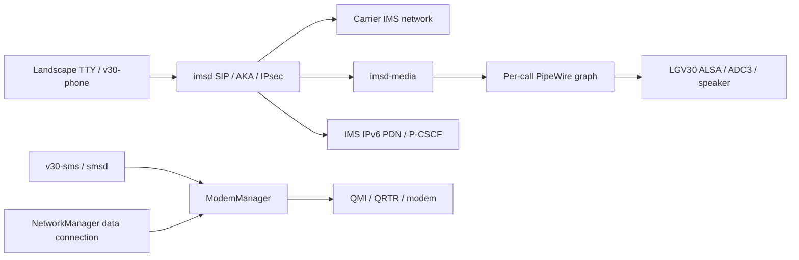

# Architecture and component map

## Boot and data connectivity

The reference ordering is `v30-modem-modules` -> `rmtfs/tqftpserv` -> `v30-wifi` -> NetworkManager. Audio settles before the carrier-specific radio policy. `v30-ipa` explicitly loads IPA on the pinned older kernel; `v30-cellular` uses the distribution's D-Bus activation for ModemManager, and `v30-ims` supervises IMS. Do not add duplicate ModemManager or polkit instances.

Data and IMS use separate connections. NetworkManager manages data. The IMS script finds or creates its designated PDN, configures the modem-assigned address, discovers P-CSCF, and installs specific host routes and input rules. It does not make the IMS interface the system IPv6 default route.

## Call lifecycle

`runtime/voice/ims_supervisor.py` preserves carrier backoff across process restarts and boots. It owns its child processes, bearer bookkeeping, private directories, and firewall rules restricted to the IMS interface/address. Call control requires an explicit Dial/Accept request; there is no automatic live-test controller.

`call_media.py` validates the parent imsd executable, process start time and boot identity before acquiring an exclusive audio lock. `audio_session.py` saves mixer state and starts a temporary PipeWire graph. `link.py` links only the verified media process's pw-record/pw-play helpers. Normal teardown and failure paths restore mixers and close PCM devices. Checking /proc/PID/exe avoids the transient-empty-cmdline identity race.

The reference uses MultiMedia1 capture and MultiMedia2 speaker playback. Hold, transfer, route switching and complete SDP media renegotiation are unqualified. The old-kernel gates, debug-ABI checks and dedicated v30/UID10000 audio user are part of that version-specific reference. Removing assertions would not establish compatibility with a different kernel.

The optional [incoming-alert service](incoming-alerts.md) observes imsd through read-only D-Bus methods/signals. It wakes the display, adds a transient caller row and maintains a private SQLite call history. A configured ringtone level and persistent missed-call/unread-SMS counters appear in the TTY status area. Its playback-only ringtone yields the shared audio lock to a call-media priority reservation. Scoped device observations and later playback/notification changes are separated in the feature document.

## SMS

`runtime/sms/sms_bus.py` adapts Gio system-bus calls and binds object paths to a bus owner and boot. `smsd.py` archives complete received messages and follows Messaging.Messages to inventory startup messages. `sms_core.py` stores a private SQLite archive, local read state and durable send intent.

Sending proceeds as local intent commit -> Create -> Send -> state reconciliation. Reusing a request ID does not resend. A lost response or crash leaves an unknown/pending record. The receiver never sends, auto-replies or deletes original modem messages. `submitted` reports network-submission state; actual receipt requires recipient confirmation or a delivery report. The CLI currently normalizes unprefixed eleven-digit Chinese mobile numbers to +86; other destinations should use full international format.

## Console and power

`runtime/support/` reads battery, CPU/GPU, temperature, memory, storage and network status. It pauses updates while the display is blanked, and shares a lock with display control. A short power-key press toggles the display; this is not system suspend. The font utility scales the device's captured 8x16 font and adds a Celsius glyph while preserving normal login authentication. Bluetooth-off is an explicit profile choice.

`v30-charge-limit.py` uses charge_behaviour to request 75% resume/80% inhibition, with conservative sensor, temperature and charger-health decisions. Hardware checks covered charge inhibition and retained USB input power. Hysteresis and abnormal-temperature decisions have logic-test coverage only; they are not a battery-safety certification or a substitute for existing hardware safeguards.
