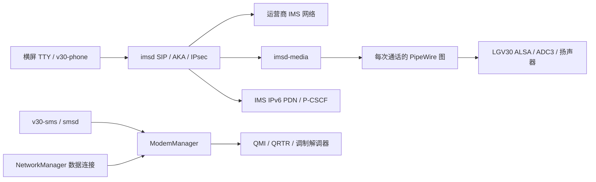

# 架构与文件对应

## 启动与数据路径

`v30-modem-modules` → `rmtfs/tqftpserv` → `v30-wifi` → NetworkManager。
音频先于特定运营商 radio 策略稳定；`v30-ipa` 明确加载旧内核的 IPA，随后
`v30-cellular` 使用发行版原生 D-Bus 激活 ModemManager，`v30-ims` 管理 IMS。
不要额外启动重复的 ModemManager/polkit 实例。

数据和 IMS 是不同连接。数据由 NetworkManager 管理；IMS 脚本发现或创建指定
PDN、分配 modem 给出的地址、读取 P-CSCF，配置精确主机路由及输入规则，
不把 IMS 接口改成系统 IPv6 默认路由。

## 通话生命周期

`runtime/voice/ims_supervisor.py` 保存运营商退避，不因进程/开机重置拒绝等待；
管理子进程、所属 bearer、私有目录和精确接口/地址的防火墙规则。收到用户明确
Dial/Accept 才开始对应动作，没有自动来电测试器。

`call_media.py` 校验父 imsd 的 executable、启动时刻和当前 boot 身份，获取独占
音频锁。`audio_session.py` 保存混音器，建立临时 PipeWire 图。`link.py` 只连接
已验证媒体进程的 pw-record/pw-play。正常 BYE、崩溃或失败路径均清理图、恢复
混音器并关闭 PCM。使用 /proc/PID/exe 处理瞬时空 cmdline 的进程身份竞态。

当前固定为 MultiMedia1 采集、MultiMedia2 扬声器播放。保持、转接、换路由和完整
SDP 媒体重协商没有验收。旧内核门禁、debug ABI 检查及专用 v30/UID10000 用户
属于当前锁定组合的一部分，不能通过删除断言来宣称新版本可用。

## 短信

`runtime/sms/sms_bus.py` 是 Gio 系统总线适配；对象路径绑定 bus owner 和 boot。
`smsd.py` 跟踪完整接收状态，并沿 Messaging.Messages 补录启动时已有短信。
`sms_core.py` 保存私有 SQLite 档案、只读/未读状态与发送意图。

发送顺序是：先提交本地请求 → Create → Send → 同步状态。相同 request-id 不重发；
响应丢失/崩溃时保留 unknown/pending。接收服务从不发送、自动回复或删除 modem
原始短信。`submitted` 只表示网络提交状态，实际送达还要对端或送达报告确认。
CLI 目前将无前缀的十一位中国手机号规范为 +86，其他地区请用完整国际格式。

## 文字界面与电源

`runtime/support/` 中状态栏读取电量、CPU/GPU、温度、内存、存储和网络状态；
熄屏时暂停变化，亮屏控制和刷新共享锁。电源键短按只切屏，不冒充 suspend。
字体从设备自己原有的 8×16 字形读取，缩放并补摄氏符号；正常登录认证仍保留。
蓝牙关闭是本配置的明确偏好。

`v30-charge-limit.py` 使用标准 charge_behaviour，75% 恢复/80% 停充，并按传感器、
温度及 charger health 作保守决策。它不替代硬件充电保护，不切断 USB 电源路径。
